# CALLBACK Standard flow

This board translates CALLBACK's authoritative Standard game into the same visual grammar as the Anthum mini-game concept board: each mini-game is a vertical column, the match reads left to right, actions use coral rectangles, decisions use teal diamonds, start/end states use white pills, and yellow notes explain backstage behavior or non-negotiable rules.

Edit any label or connector directly in the Mermaid source below. Most Markdown previews, GitHub, and Mermaid-compatible editors render the diagram automatically.

```mermaid
flowchart LR
  subgraph SETUP["ROOM SETUP"]
    direction TB
    A0([Create room]):::terminal --> A1[Players join on phones]:::process
    A1 --> A2{Ready to start?}:::decision
    A2 -->|No| A1
    A2 -->|2–10 active seats<br/>or solo + bots| A3[Host starts game]:::process
    A3 --> A4[Game intro · 4 seconds]:::process
  end

  subgraph SEED["1 · THE SEED"]
    direction TB
    S0[Round intro]:::process --> S1[Players invent a reusable<br/>character, product, object, place,<br/>business, vehicle, or mascot]:::process
    S1 --> S2[Answer lock]:::process
    S2 --> S3{At least two<br/>visible answers?}:::decision
    S3 -->|Yes| S4[Anonymous applause vote]:::process
    S4 --> S5[Vote lock]:::process
    S3 -->|No| S6[Score creative answers]:::process
    S5 --> S6
    S6 --> S7[Reveal answer authors<br/>and winner or tied winners]:::process
    S7 --> S8[Only winners enter Room Lore<br/>as ANCHOR memories]:::memory
    S8 --> S9[Round results]:::process
    SN[Queue the winning Anchor image.<br/>Solo and failures use a deterministic<br/>concept card; play never waits on AI.]:::note
    S8 -. backstage .-> SN
  end

  subgraph READ["2 · READ THE ROOM"]
    direction TB
    R0[Round intro]:::process --> R1[Each player makes<br/>a private personal choice]:::process
    R1 --> R2[Everyone predicts the<br/>room-wide distribution]:::process
    R2 --> R3[Server scores prediction accuracy]:::process
    R3 --> R4[Reveal the real distribution]:::process
    R4 --> R5[Round results]:::process
    RN[This social round hides<br/>Anchor-image processing latency.]:::note
    R2 -. gives time to .-> RN
  end

  subgraph REAL["3 · MAKE IT REAL"]
    direction TB
    M0[Round intro]:::process --> M1[Reveal the winning Anchor image<br/>or its concept-card fallback]:::process
    M1 --> M2[Players write what the<br/>established Anchor says]:::process
    M2 --> M3[Answer lock → anonymous vote<br/>→ vote lock]:::process
    M3 --> M4[Server scores and reveals]:::process
    M4 --> M5[Only winners enter Room Lore<br/>as VOICE memories]:::memory
    M5 --> M6[Persist graph edge:<br/>ANCHOR — SAYS → VOICE]:::memory
    M6 --> M7[Round results]:::process
  end

  subgraph CATCH["4 · THE CATCH"]
    direction TB
    C0[Round intro]:::process --> C1[Show an independent World prompt<br/>plus one mechanical comedy constraint]:::process
    C1 --> C2[Players write a World memory]:::process
    C2 --> C3{Answer passes<br/>the Catch validator?}:::decision
    C3 -->|No · before deadline| C2
    C3 -->|Yes| C4[Answer lock → anonymous vote<br/>→ vote lock]:::process
    C4 --> C5[Server scores and reveals]:::process
    C5 --> C6[Only winners enter Room Lore<br/>as WORLD memories]:::memory
    C6 --> C7[Persist graph edge:<br/>WORLD — COLLIDES WITH → ANCHOR]:::memory
    C7 --> C8[Round results]:::process
    CN[The displayed Catch wording may change,<br/>but its mechanical validator must not loosen.]:::note
    C1 -. invariant .-> CN
  end

  subgraph CROWD["5 · CROWD CONTROL"]
    direction TB
    G0[Round intro]:::process --> G1[Each player privately<br/>points at one player]:::process
    G1 --> G2[Everyone predicts the<br/>full group distribution]:::process
    G2 --> G3[Server scores prediction accuracy]:::process
    G3 --> G4[Reveal the room's choices]:::process
    G4 --> G5[Round results]:::process
    GN[This social round gives backstage work<br/>time to prepare a safe callback candidate.]:::note
    G2 -. gives time to .-> GN
  end

  subgraph CALLBACK["6 · CALLBACK"]
    direction TB
    B0[Round intro rewinds the room's<br/>ANCHOR + VOICE + WORLD]:::process --> B1{Usable connected<br/>callback candidate?}:::decision
    B1 -->|Yes| B2[Use the highest-quality safe,<br/>answerable candidate]:::process
    B1 -->|No| B3[Build the deterministic<br/>causal fallback prompt]:::process
    B2 --> B4[Players answer the open<br/>consequence question]:::process
    B3 --> B4
    B4 --> B5[Answer lock → anonymous vote<br/>→ vote lock]:::process
    B5 --> B6[Score answers and award<br/>callback royalties to source authors]:::process
    B6 --> B7[Reveal winner or tied winners]:::process
    B7 --> B8[Only winners enter Room Lore<br/>as CONSEQUENCE memories]:::memory
    B8 --> B9[Persist CAUSES and<br/>ESCALATES TO graph edges]:::memory
    B9 --> B10[Round results]:::process
    BN[AI may connect established memories.<br/>It cannot choose winners, scores, timing,<br/>authorship, identities, or eligibility.]:::note
    B1 -. authority boundary .-> BN
  end

  subgraph REMIX["7 · THE REMIX"]
    direction TB
    X0[Final-round intro rewinds<br/>the connected memory trail]:::process --> X1{Usable Remix<br/>candidate?}:::decision
    X1 -->|Yes| X2[Use 3–4 compatible<br/>established memories]:::process
    X1 -->|No| X3[Use the fixed deterministic<br/>Remix fallback]:::process
    X2 --> X4[Queue Tonight's Masterpiece<br/>or prepare concept-card fallback]:::process
    X3 --> X4
    X4 --> X5[Players write final answers]:::process
    X5 --> X6[Final anonymous vote]:::process
    X6 --> X7[Server scores and reveals]:::process
    X7 --> X8([Final results]):::terminal
    X8 --> X9[Tonight's Lore:<br/>standings + memory graph + artwork]:::memory
    X9 --> X10{What next?}:::decision
    X10 -->|Play again| X11([Return to lobby]):::terminal
    X10 -->|Monster Factory encore| X12[Run the optional cooperative encore<br/>on the normal authoritative engine]:::process
    X10 -->|Finish| X13([Post-game]):::terminal
    X12 --> X13
  end

  A4 --> S0
  S9 --> R0
  SN -. image may finish during .-> R1
  R5 --> M0
  M7 --> C0
  C8 --> G0
  G5 --> B0
  B10 --> X0
  X11 --> A1

  classDef process fill:#dc8f80,stroke:#9f4f43,color:#231f20,stroke-width:1.5px;
  classDef decision fill:#78c9c5,stroke:#367f7b,color:#172322,stroke-width:1.5px;
  classDef terminal fill:#fffdf7,stroke:#656565,color:#242424,stroke-width:1.5px;
  classDef note fill:#f5da78,stroke:#d1ab32,color:#2d281a,stroke-width:1.25px;
  classDef memory fill:#f3c85f,stroke:#b98b20,color:#2a2416,stroke-width:1.5px;
```

## Reading key

- **Coral rectangle:** a visible player, host, or server step.
- **Teal diamond:** a branch or gate.
- **White pill:** a start, result, or terminal state.
- **Gold node:** a persistent Room Lore mutation.
- **Yellow note:** backstage work, fallback behavior, or a hard authority rule.
- **Solid connector:** the authoritative match sequence.
- **Dotted connector:** asynchronous or explanatory context; it never owns phase changes.

## Format borrowed from the reference

The reference board uses narrow top-to-bottom mini-game flows arranged in a wider left-to-right sequence. Long connectors carry loops around the outside; diamonds ask the small number of questions that change the path; notes sit beside the path rather than interrupting it. This CALLBACK board keeps that structure while making the server-owned phase transitions and memory graph explicit.

## Source-of-truth mapping

- Round order, score caps, and timers: `lib/game/config.ts`
- Phase transitions and scoring effects: `server/engine.ts`
- Valid phases, actions, and memory types: `lib/contracts.ts`
- Snapshot disclosure boundary: `server/snapshots.ts`
- Product intent and callback-quality rules: `GAME_DESIGN.md` and `ROUND_SYSTEM.md`
